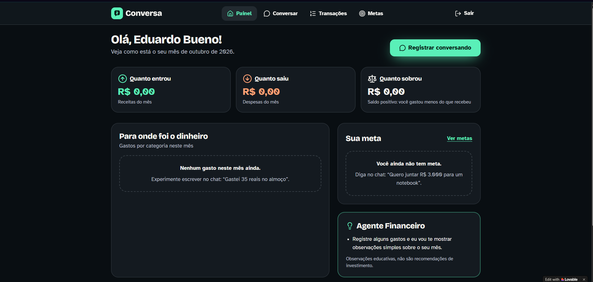
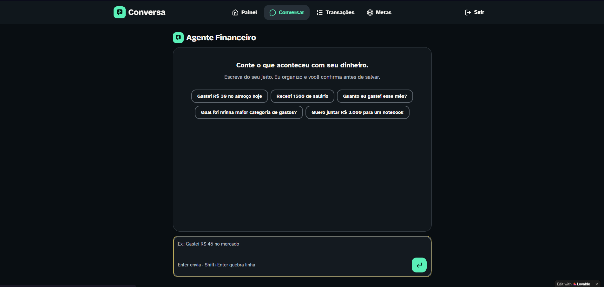
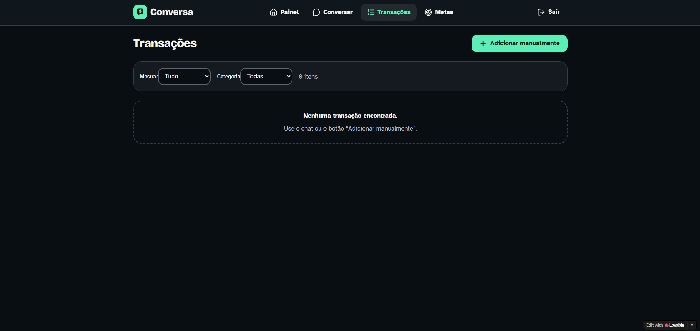
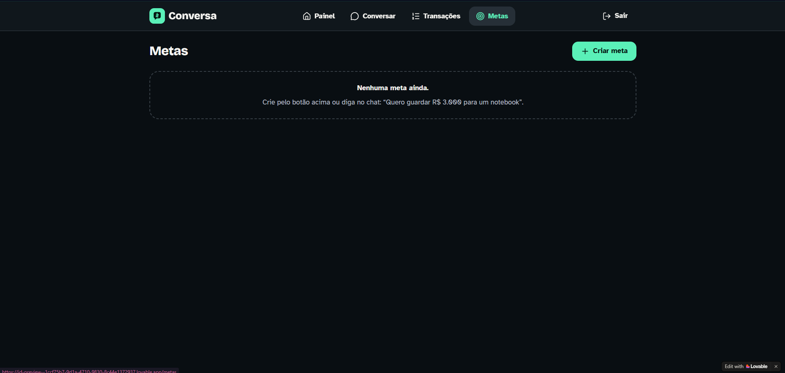

# Finance Friend | Organização Financeira com IA

### Projeto desenvolvido para o desafio de Vibe Coding da DIO

O **Finance Friend**, apresentado na aplicação como **Conversa**, é um projeto de organização de finanças pessoais desenvolvido com o auxílio de Inteligência Artificial, utilizando principalmente o **ChatGPT** para estruturar os requisitos e o **Lovable** para gerar a aplicação.

A ideia é simples: permitir que as pessoas organizem suas finanças de maneira mais prática, utilizando mensagens em linguagem natural em vez de depender exclusivamente de planilhas ou formulários.

**[Acessar aplicação](https://chatty-cents-companion.lovable.app/)** | **[Consultar PRD completo](PRD.md)** | **[Desafio original da DIO](https://github.com/digitalinnovationone/dio-lab-vibe-coding-app-financas)**

---

## Sobre o projeto

O projeto surgiu da proposta apresentada no bootcamp da DIO: desenvolver o conceito de um aplicativo de finanças pessoais utilizando Vibe Coding.

Em vez de criar apenas uma descrição teórica, decidi explorar até onde conseguiria chegar utilizando ferramentas de IA no processo de desenvolvimento.

O resultado foi um protótipo web publicado pelo Lovable, com interface para acompanhamento financeiro, registro de movimentações, metas e interação por conversa.

A proposta central é permitir que o usuário informe suas movimentações financeiras de maneira simples, por exemplo:

- "Gastei R$ 35 no almoço hoje."
- "Recebi R$ 1.500 de salário."
- "Quanto eu gastei este mês?"
- "Quero juntar R$ 3.000 para comprar um notebook."

A intenção é que o aplicativo interprete essas informações e facilite a organização dos dados financeiros.

## Como desenvolvi a ideia

### 1. Planejamento e criação do PRD

Antes de utilizar o Lovable, comecei estruturando um **PRD (Product Requirements Document)** com o auxílio do ChatGPT.

Nesse documento, defini o problema que o aplicativo deveria resolver, o público-alvo, as funcionalidades, as regras de negócio, os fluxos de navegação e os critérios de validação.

Também incluí o conceito de **Design Universal**, pensando em uma aplicação que pudesse oferecer uma boa experiência para pessoas com diferentes níveis de familiaridade com tecnologia e diferentes necessidades de acessibilidade.

Esse cuidado influenciou os requisitos de navegação, legibilidade, contraste, feedback ao usuário e simplicidade da interface.

O documento completo utilizado como orientação está disponível em **[PRD.md](PRD.md)**.

### 2. Desenvolvimento com Lovable

Com o PRD estruturado, utilizei o Lovable para transformar a especificação em uma aplicação web.

Uma das partes mais interessantes foi observar como a ferramenta interpretou as instruções e gerou uma interface com diferentes páginas, componentes e fluxos de navegação.

Durante o processo, também encontrei algumas limitações, principalmente relacionadas à quantidade de créditos disponíveis no plano gratuito. Isso me fez perceber a importância de definir prioridades e organizar melhor as solicitações enviadas à IA.

Mesmo com essas limitações, consegui chegar a uma versão publicada da aplicação.

### 3. Resultado obtido

A versão gerada apresenta as seguintes áreas:

| Área | Finalidade |
|---|---|
| **Painel** | Apresentar receitas, despesas, saldo e resumos financeiros. |
| **Conversar** | Oferecer uma interface de chat para registrar e consultar informações financeiras. |
| **Transações** | Organizar movimentações, com opções de filtragem e cadastro manual. |
| **Metas** | Permitir o planejamento e o acompanhamento de objetivos financeiros. |
| **Conta** | Oferecer cadastro, login e acesso individual à aplicação. |

Também consegui experimentar o fluxo de cadastro com verificação por e-mail, algo que foi além do que eu inicialmente esperava obter durante a atividade.

**Observação:** as telas apresentadas representam o protótipo desenvolvido. Nem todos os fluxos e requisitos foram submetidos a testes completos de funcionamento, segurança e acessibilidade.

## Capturas de tela

### Painel financeiro

Visão geral das receitas, despesas, saldo e demais informações do usuário.

### Conversa com o assistente

Interface conversacional com sugestões de mensagens para registrar ou consultar movimentações financeiras.

### Transações

Página destinada ao histórico e à organização das movimentações financeiras.

### Metas financeiras

Área dedicada ao cadastro e acompanhamento de objetivos financeiros.

## O que aprendi com o desafio

### O que funcionou bem?

O planejamento inicial por meio do PRD ajudou bastante. Ter uma descrição clara do problema, das funcionalidades e do comportamento esperado tornou mais fácil orientar o Lovable.

Também gostei da rapidez com que foi possível transformar uma ideia em uma interface navegável, sem precisar desenvolver manualmente cada componente.

Outro ponto positivo foi conseguir incluir requisitos de Design Universal desde o planejamento, em vez de pensar em acessibilidade somente depois da criação das telas.

### O que não funcionou como eu esperava?

A principal dificuldade foi trabalhar com os limites de créditos do Lovable. Como meu PRD ficou bastante detalhado, percebi que nem sempre é interessante solicitar muitas funcionalidades de uma só vez, principalmente quando existem restrições de uso.

Além disso, gerar uma interface visualmente completa não significa que todas as funcionalidades estejam prontas ou corretamente implementadas. Ainda é necessário testar os fluxos, validar os dados e verificar se o comportamento corresponde ao que foi solicitado.

### O que aprendi sobre conversar com IAs?

Aprendi que a qualidade do resultado depende bastante da maneira como explicamos o que queremos.

Um prompt bem estruturado precisa apresentar contexto, objetivos, restrições e critérios claros. Ao mesmo tempo, também precisa ter um escopo adequado à ferramenta e aos recursos disponíveis.

O desafio me ajudou a entender melhor que Vibe Coding não é simplesmente pedir para uma IA criar um aplicativo. É um processo de planejamento, comunicação, experimentação, avaliação e ajustes.

## Próximos passos

O Finance Friend ainda pode evoluir bastante. Entre as melhorias que pretendo explorar estão a validação dos registros realizados pelo chat, testes mais completos das funcionalidades financeiras, melhorias de acessibilidade e refinamentos na experiência do usuário.

Também gostaria de aprofundar meus conhecimentos sobre a arquitetura e o código gerado, para compreender melhor as decisões técnicas tomadas durante o desenvolvimento.

## Considerações finais

Esse desafio foi uma oportunidade de experimentar uma abordagem diferente de desenvolvimento de software.

Mais do que obter uma aplicação visualmente pronta, o principal aprendizado foi perceber a importância de saber transformar uma ideia em requisitos claros, avaliar os resultados produzidos pela IA e reconhecer as limitações das ferramentas utilizadas.

O projeto representa um primeiro experimento prático com Vibe Coding e uma base para continuar estudando desenvolvimento de aplicações com apoio de Inteligência Artificial.

---

**Desenvolvido por Eduardo Rodrigues Bueno**

[GitHub](https://github.com/EduuR07) | [LinkedIn](https://www.linkedin.com/in/eduardobueno07/) | [Aplicação](https://chatty-cents-companion.lovable.app/)

*Projeto realizado como parte do desafio de Vibe Coding da Digital Innovation One (DIO).*
